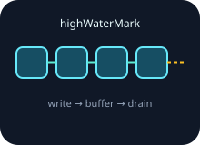

## 🧭 Overview

A dependency-free Node.js CLI that demonstrates Writable stream buffering, write() return values, highWaterMark, and drain events with a deliberately slow sink.

## ✨ Features

- 🌊 Observe write() returning false when the buffer reaches its limit.
- ⏳ Watch a slow Writable process queued chunks.
- 🔔 Wait for drain before writing more data.
- 🧪 Test the backpressure path with node:test.

## 🎬 Demo

No hosted demo is provided. Run the local example with the command below.

## ⚡ Quick Start

~~~bash
npm start
~~~

## 🧰 Tech Stack

- Node.js 18+
- Local-first execution; no external API calls

## 🗂️ Folder Structure

~~~text
node-stream-backpressure-lab/
├── src/main.js
├── test/backpressure.test.js
├── package.json
├── assets/mark.svg
├── .gitignore
├── LICENSE
└── README.md
~~~

## 🗺️ Roadmap

- [x] Core behavior and local examples
- [x] Custom SVG and setup documentation
- [ ] Add more guided exercises from community feedback

## 🤝 Contributing

Issues and focused pull requests are welcome. Keep examples reproducible and within the documented scope.

## 📄 License

MIT License. See [LICENSE](LICENSE).

